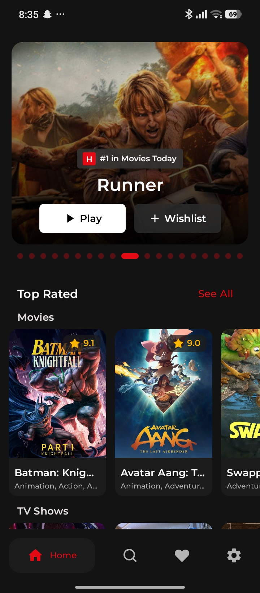
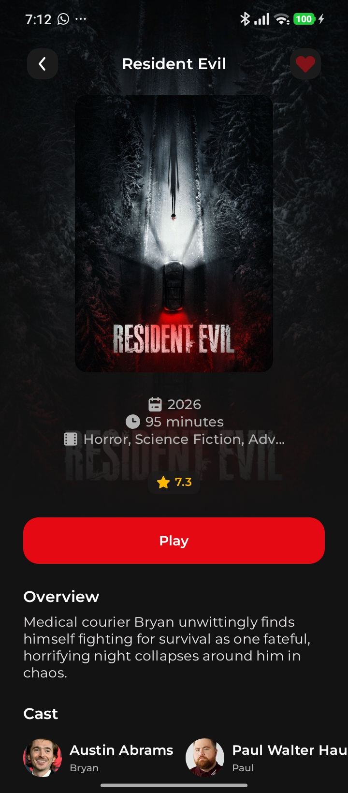
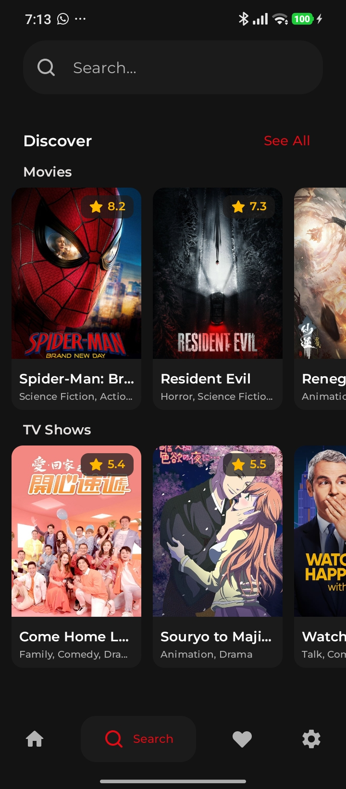
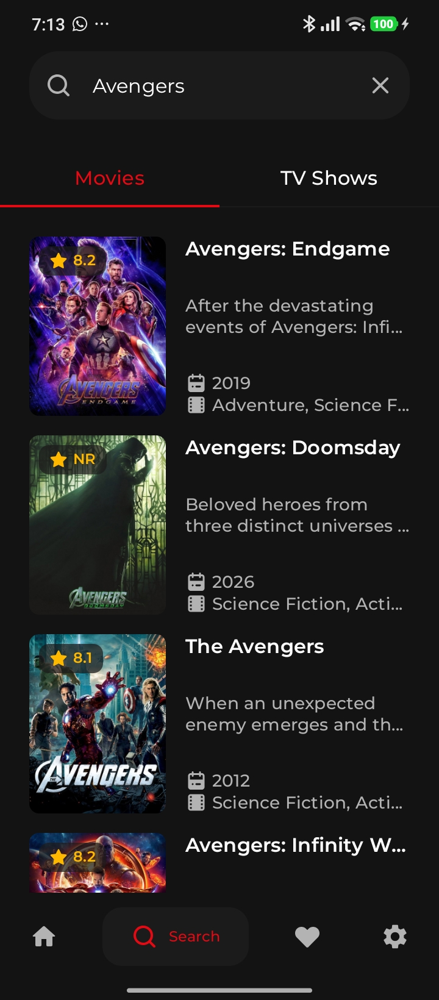
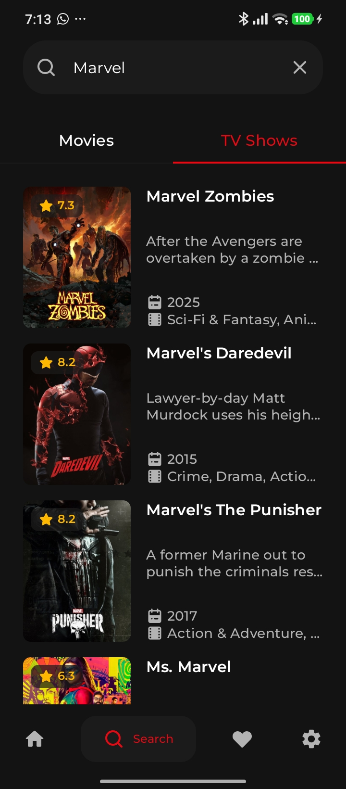
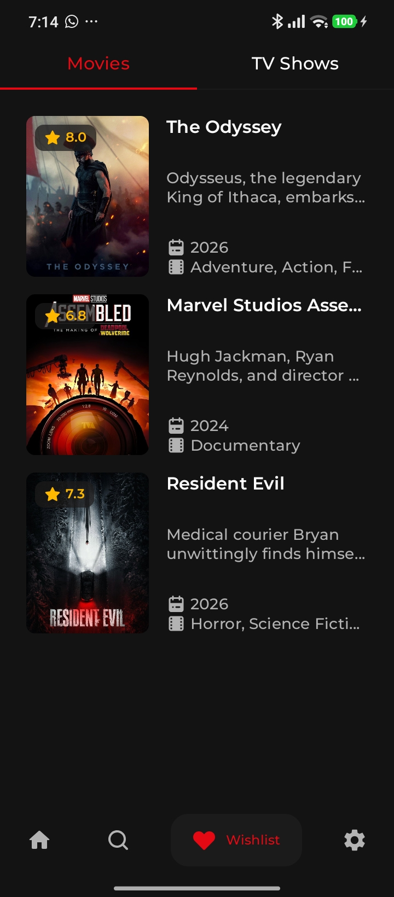
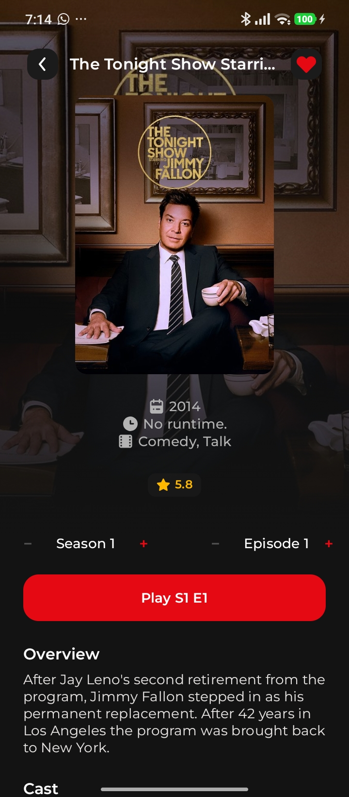
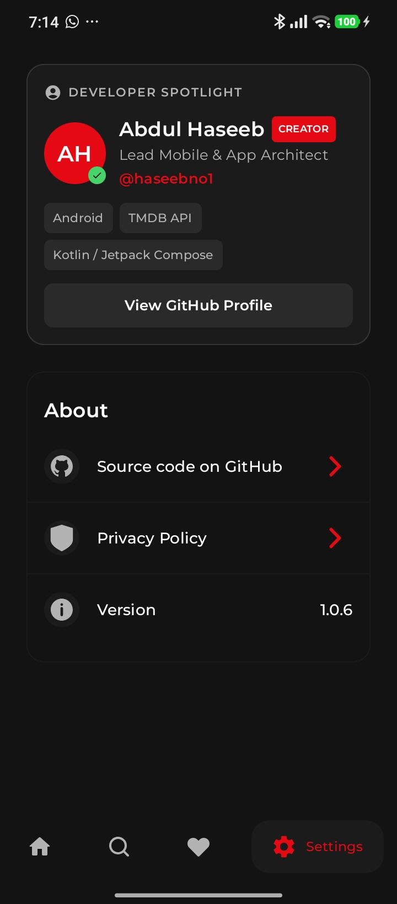

<p align="center">
  
</p>

<h1 align="center">HaseebFlix</h1>

<p align="center">
  Discover movies and TV shows, keep a watchlist, and play titles in the app through a third-party provider.
</p>

[](https://rookieenough.github.io/Orion-Data/app/?id=haseebflix)


<p align="center">
  <a href="https://github.com/haseebno1/Haseeb-Flix/releases/latest"></a>
  
  <a href="LICENSE"></a>
</p>

## Features

- Browse popular, top-rated and upcoming movies and TV shows
- Search movies and TV series
- Details, cast and crew, and season and episode selection for series
- Watchlist stored in app data, no account needed
- In-app playback through a third-party embed provider (see [Where content comes from](#where-content-comes-from))
- Dark Jetpack Compose interface

## Install

Download the signed APK from the [latest release](https://github.com/haseebno1/Haseeb-Flix/releases/latest) (`HaseebFlix-vX.Y.Z.apk`) and open it. Android will ask you to allow installs from your browser or file manager the first time.

To check the download, compare it with the `.sha256` file attached to the same release:

```sh
sha256sum -c HaseebFlix-vX.Y.Z.apk.sha256
```

You can also add `https://github.com/haseebno1/Haseeb-Flix` to an update tracker such as [Obtainium](https://github.com/ImranR98/Obtainium) to be notified of new releases.

> **Upgrading from an older build?** The application ID changed to `com.haseebno1.haseebflix` in 1.1.0. It installs next to the old app and does not carry over your watchlist.

## Screenshots

<p>
  
  
  
  
</p>
<p>
  
  
  
  
</p>

## Where content comes from

- **Catalogue data** (titles, posters, descriptions, cast) comes from [The Movie Database (TMDB)](https://www.themoviedb.org/).
- **Video playback** comes from a third-party embed provider, loaded in a web view. The base URL defaults to `https://embed.vidrift.net` and can be changed at build time (see below).
- We don't host the content on our servers — we're just an aggregator. Think of us as a friendly guide: we point you to movies and shows that are hosted and streamed by third-party providers, so the credit (and any quirks) belongs to them, not us.
- VidRift's written reply (recorded in [`docs/content-authorization.md`](docs/content-authorization.md)) says HaseebFlix may embed its player for free and that public embeds show one ad. VidRift also says it does not own or store the media; rights for individual titles have not been independently verified. The embedded player may use its own storage; its exact storage and advertising data practices have not been independently audited.

## Privacy

HaseebFlix has no app account flow. The Room database (watchlist and catalogue cache) is included in cloud backup and device transfer; other app files and preferences are excluded by explicit Android backup rules. The TMDB key is compiled into the app and is not stored in backup data. No direct analytics SDK was identified in the inspected app source. The app contacts TMDB and its image CDN for catalogue information, and VidRift when a video is started; those services can receive network metadata such as your IP address and requested title identifiers. VidRift says its embedded player uses its own storage and that public embeds show one ad; exact storage and ad data handling have not been independently verified.

## Building from source

Requirements: JDK 17 and the Android SDK (Android Studio recommended).

```sh
git clone https://github.com/haseebno1/Haseeb-Flix.git
cd Haseeb-Flix
```

Provide a [TMDB API key](https://developer.themoviedb.org/docs/getting-started). Either add it to `local.properties` (git-ignored):

```properties
haseebflix.apikey=YOUR_TMDB_API_KEY
# optional: use a different embed provider (must be https)
haseebflix.player.baseurl=https://your-provider.example
```

or export `HASEEBFLIX_API_KEY` (and optionally `HASEEBFLIX_PLAYER_BASE_URL`) in your environment. Then:

```sh
./gradlew assembleDebug     # debug APK in app/build/outputs/apk/debug
./gradlew testDebugUnitTest # unit tests
```

Release builds are signed using a git-ignored `keystore.properties` in the project root with the keys `storeFile`, `storePassword`, `keyAlias` and `keyPassword`. Without it the build falls back to the debug key, so never distribute that APK.

### Project layout

```
app/          Application module, navigation host and Hilt entry point
core/         Shared modules: common, data, database, datastore, network, domain, model, ui, designsystem, navigation
features/     Screens: home, search, wishlist, settings, list, details, player
benchmark/    Macrobenchmark and baseline profile generation
build-logic/  Gradle convention plugins (haseebflix.*)
config/       Detekt and Spotless configuration
fastlane/     Store metadata (descriptions, changelogs, screenshots)
```

## Releasing

Releases are built by GitHub Actions when a version tag is pushed.

1. Bump `versionCode` and `versionName` in `app/build.gradle.kts`.
2. Add `fastlane/metadata/android/en-US/changelogs/<versionCode>.txt` (500 bytes max). It becomes the release notes.
3. Merge to `main`, then tag and push:

   ```sh
   git tag v1.1.0 && git push origin v1.1.0
   ```

The workflow checks that the tag equals `versionName`, builds a signed release APK, verifies it is not debug-signed, and publishes `HaseebFlix-vX.Y.Z.apk` and a `.sha256` file to the release. Tags with a suffix such as `v1.2.0-rc1` are marked as pre-releases.

Add these repository secrets once under **Settings → Secrets and variables → Actions**:

| Secret | Value |
| --- | --- |
| `ANDROID_KEYSTORE_BASE64` | Your release keystore, base64-encoded (`base64 -w0 release.jks`) |
| `ANDROID_KEYSTORE_PASSWORD` | Keystore password |
| `ANDROID_KEY_ALIAS` | Key alias |
| `ANDROID_KEY_PASSWORD` | Key password |
| `TMDB_API_KEY` | TMDB API key to embed in the build |

Keep the same keystore for every release; Android refuses updates signed with a different key.

## Contributing

Issues and pull requests are welcome. CI builds the app and runs the unit tests on every pull request.

## Store submission preparation

HaseebFlix `v1.1.0` is tagged and published as a signed release, with `HaseebFlix-v1.1.0.apk` and its `.sha256` checksum attached. Store submission to Orion Store has been filed from the draft package in [`store-submission/`](https://github.com/haseebno1/Haseeb-Flix/blob/main/store-submission/README.md).

Playback is delivered by the VidRift embed provider, whose written reply records permission to embed its player for free. VidRift does not own or store the media, so title-level upstream rights remain unverified; that is tracked in [`docs/content-authorization.md`](https://github.com/haseebno1/Haseeb-Flix/blob/main/docs/content-authorization.md) and does not block submission.

Remaining work is listing preparation for further stores. GitHub Releases and Obtainium already provide working direct distribution.

## License and credits

HaseebFlix is licensed under the [Apache License 2.0](LICENSE). It is derived from an Apache-2.0 open-source Android project; the original copyright notices are kept in the source files and [NOTICE](NOTICE) has the attribution and a statement of changes.

Maintained by [Abdul Haseeb](https://github.com/haseebno1).

This product uses the TMDB API but is not endorsed or certified by TMDB.
